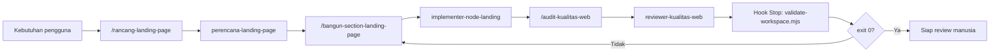

# TrainingAI

## Orkestrasi Copilot `.github`

Sistem kerja bersama untuk membangun, merapikan, dan memvalidasi dua halaman landing di `portofolio/` dan `welcome-aboard/`.

Tujuan orkestrasi:

1. Memisahkan peran kerja menjadi perencanaan, implementasi, dan review.
2. Menjaga aturan proyek tetap konsisten tanpa bergantung pada ingatan setiap sesi.
3. Menjalankan validasi deterministik sehingga kegagalan tidak tertutup oleh klaim berhasil.

## Struktur proyek yang dijaga

```text
TrainingAI/
├── .github/                # orkestrasi (dokumen ini)
│   ├── agents/
│   ├── hooks/
│   ├── instructions/
│   ├── prompts/
│   ├── skills/
│   ├── copilot-instructions.md
│   └── README.md
├── portofolio/             # index.html + styles.css
├── welcome-aboard/         # index.html + styles.css
│   └── assets/             # 9 SVG — satu-satunya folder aset
├── package.json            # tanpa dependencies
├── server.mjs              # server statis node:http
└── Step-Step.docx
```

Aturan aset: satu `welcome-aboard/assets/` sebagai sumber tunggal. `welcome-aboard/` merujuk `assets/...`, `portofolio/` merujuk `../welcome-aboard/assets/...`. Tidak ada duplikasi aset.

## Fungsi setiap folder

| Folder | Fungsi | Kapan digunakan |
|---|---|---|
| [`agents/`](./agents/) | Persona spesialis dengan peran, batas tool, dan format keluaran tetap. | Saat pekerjaan perlu dipisah menjadi perencana, implementer, dan reviewer. |
| [`hooks/`](./hooks/) | Automasi deterministik pada lifecycle agent: validasi struktur, aset, dan keamanan. | Saat validasi harus selalu berjalan dan kegagalan harus terlihat. |
| [`instructions/`](./instructions/) | Aturan yang dimuat berdasarkan tipe berkas (`applyTo`). | Saat aturan HTML, CSS, Node.js, dan dokumentasi perlu dibedakan. |
| [`prompts/`](./prompts/) | Template tugas sekali pakai yang dipanggil dengan `/`. | Saat menjalankan pekerjaan berulang dengan input konsisten. |
| [`skills/`](./skills/) | Workflow multi-langkah beserta checklist dan kriteria penerimaan. | Saat membangun atau mengaudit halaman secara end-to-end. |
| [`copilot-instructions.md`](./copilot-instructions.md) | Aturan proyek yang selalu aktif pada setiap permintaan. | Selalu; tidak perlu dipanggil manual. |

## Isi setiap folder

### `agents/`

| Agen | Peran | Tools |
|---|---|---|
| `perencana-landing-page` | Memecah kebutuhan menjadi section, acceptance criteria, dan risiko. | `read`, `search` |
| `implementer-node-landing` | Mengubah HTML/CSS/JS dengan diff sekecil mungkin. | `read`, `search`, `edit`, `execute` |
| `reviewer-kualitas-web` | Mengaudit aksesibilitas, responsivitas, SEO, performa. | `read`, `search`, `execute` |

Setiap agen menyebut dua halaman sasaran beserta prefix asetnya.

### `hooks/`

| Berkas | Event | Fungsi |
|---|---|---|
| `inject-project-context.json` | `SessionStart` | Menyuntikkan struktur root, dua halaman, dan aturan path aset. |
| `guard-dangerous-commands.json` | `PreToolUse` | Memblokir perintah destruktif dan eksfiltrasi. |
| `guard-env-files.json` | `PreToolUse` | Mencegah pembuatan atau pengubahan berkas `.env`. |
| `guard-env-commit.json` | `PreToolUse` | Mencegah `.env` atau nilai menyerupai secret ikut di-commit. |
| `check-html-assets.json` | `PostToolUse` | Melaporkan referensi aset, anchor, dan `h1` bermasalah (non-blocking). |
| `check-customization-frontmatter.json` | `PostToolUse` | Memvalidasi frontmatter markdown dan JSON hook (non-blocking). |
| `validate-workspace.json` | `Stop` | Validasi penuh; gagal menghentikan sesi. |

Folder `scripts/` berisi implementasi Node.js untuk setiap hook:

| Script | Fungsi |
|---|---|
| `lib/project.mjs` | Utilitas bersama: `ROOT`, `PAGES`, `ASSET_DIR`, `REQUIRED_ASSETS`, `GITHUB_DIRS`, `HOOK_PAIRS`, `validatePage`, pembacaan stdin, dan emisi keputusan hook. |
| `guard-dangerous-commands.mjs` | Pencocokan pola perintah berisiko. |
| `guard-env-files.mjs` | Deteksi pembuatan atau pengubahan `.env`. |
| `guard-env-commit.mjs` | Deteksi `.env` atau secret pada operasi git. |
| `check-html-assets.mjs` | Pemeriksaan aset, anchor, dan heading pada dua halaman. |
| `check-customization-frontmatter.mjs` | Pemeriksaan frontmatter dan JSON hook. |
| `inject-project-context.mjs` | Konteks awal sesi. |
| `validate-workspace.mjs` | Validasi penuh saat sesi berakhir. |

Guard memakai `permissionDecision: "deny"` sehingga agent menerima alasan yang jelas. Hook `PostToolUse` hanya melaporkan lewat `systemMessage` agar tidak menghentikan pekerjaan.

### `instructions/`

| Berkas | `applyTo` | Fokus |
|---|---|---|
| `html-landing-page.instructions.md` | `**/*.html` | Semantik, satu `h1`, `alt`, anchor, prefix aset per halaman. |
| `css-landing-page.instructions.md` | `**/*.css` | Token `:root`, mobile-first, `:focus-visible`, `prefers-reduced-motion`. |
| `node-landing-page.instructions.md` | `**/*.mjs`, `**/*.cjs`, `**/package.json` | API bawaan Node.js, nol dependensi, validasi input, error handling. |
| `documentation.instructions.md` | `**/*.md` | Bahasa, struktur heading, tautan relatif, akurasi path. |

### `prompts/`

| Prompt | Fungsi |
|---|---|
| `/rancang-landing-page` | Menyusun rencana dan acceptance criteria sebelum coding. |
| `/bangun-section-landing-page` | Membangun atau merevisi satu section dengan peta class. |
| `/audit-kualitas-web` | Audit aksesibilitas, responsif, SEO, dan performa. |
| `/siapkan-review` | Merangkum perubahan untuk review manusia. |

### `skills/`

```text
skills/node-landing-page/
├── SKILL.md
└── references/
    ├── acceptance.md
    └── checklist.md
```

`SKILL.md` memuat workflow 8 langkah, struktur proyek, aturan aset, dan peta section. `checklist.md` memuat daftar periksa operasional; `acceptance.md` memuat 21 kriteria yang dapat diverifikasi.

## Alur orkestrasi



Pemetaan primitive ke kebutuhan:

| Kebutuhan | Primitive |
|---|---|
| Aturan yang selalu berlaku | `copilot-instructions.md` |
| Aturan khusus tipe berkas | `instructions/` dengan `applyTo` |
| Pekerjaan berulang satu tugas | `prompts/` |
| Workflow panjang dengan checklist | `skills/` |
| Pemisahan peran dan batas tool | `agents/` |
| Validasi yang tidak boleh dilewati | `hooks/` |

## Cara memakai

1. Mulai dari `/rancang-landing-page` bila kebutuhan masih kasar.
2. Delegasikan implementasi ke `implementer-node-landing` agar konteks tetap fokus.
3. Jalankan `/audit-kualitas-web` sebelum meminta review manusia.
4. Biarkan hook `Stop` menjalankan validasi; perbaiki temuan sampai bersih.
5. Gunakan `/siapkan-review` untuk merangkum perubahan.

## Validasi manual

```powershell
# Konteks sesi (dipakai hook SessionStart)
node .github/hooks/scripts/inject-project-context.mjs

# Pemeriksaan cepat halaman (dipakai hook PostToolUse, non-blocking)
node .github/hooks/scripts/check-html-assets.mjs

# Pemeriksaan frontmatter dan JSON hook (non-blocking)
node .github/hooks/scripts/check-customization-frontmatter.mjs

# Validasi penuh (dipakai hook Stop, blocking)
node .github/hooks/scripts/validate-workspace.mjs
```

Atau lewat npm:

```powershell
npm start            # server http://localhost:3000/
npm run check        # validasi penuh
npm run check:assets # pemeriksaan aset + anchor + h1
```

## Runtime

`server.mjs` menyajikan dua halaman dari root proyek:

| Rute | Menyajikan |
|---|---|
| `/` | redirect ke `/welcome-aboard/` |
| `/welcome-aboard/` | `welcome-aboard/index.html` |
| `/portofolio/` | `portofolio/index.html` |
| `/welcome-aboard/assets/*` | 9 SVG bersama |

Tanpa dependensi eksternal. Hanya modul bawaan Node.js.

## Pemecahan masalah

| Gejala | Penyebab | Solusi |
|---|---|---|
| `node` tidak dikenali | Node.js belum terpasang atau PATH belum dimuat | Pasang Node.js LTS, buka terminal baru, cek `node -v` |
| `npm run check` gagal di aset | Prefix path salah untuk halaman tersebut | `welcome-aboard` -> `assets/`, `portofolio` -> `../welcome-aboard/assets/` |
| `EADDRINUSE` | Port 3000 dipakai proses lain | `$env:PORT=3001; npm start` |
| Hook tidak berjalan | `node` tidak ada di PATH saat hook dipanggil | Pastikan Node.js terpasang global |
